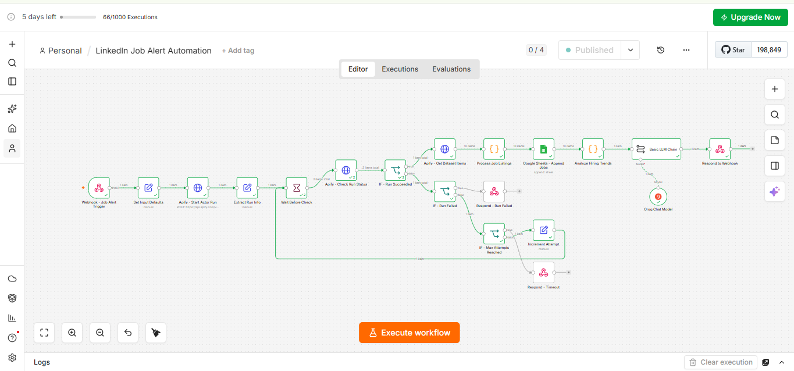
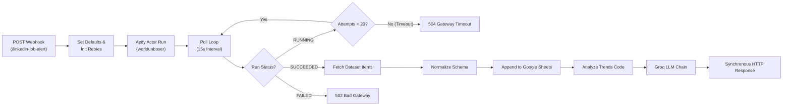
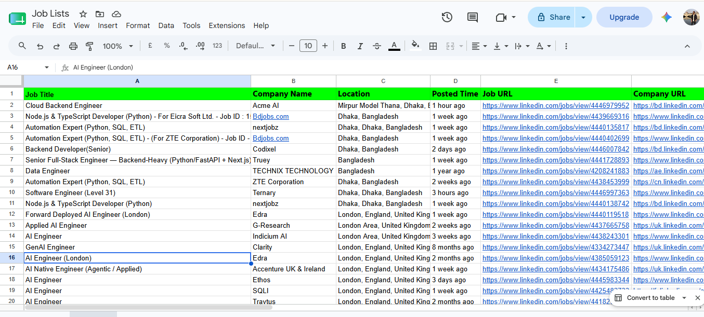

# LinkedIn Job Alert & Market Trend Intelligence Automation

[](https://n8n.io/)
[](https://apify.com/)
[](https://groq.com/)
[](https://www.google.com/sheets/about/)
[](LICENSE)

An enterprise-ready **n8n orchestration workflow** that automates targeted LinkedIn job scraping, persists structured listing data into **Google Sheets**, performs AI-driven market and hiring trend analysis via **Groq LLM**, and returns immediate trend intelligence synchronously via webhook.

---

## 📌 Workflow Canvas



> 📹 **Video Demo**: A full execution recording is available in [`assets/demo-execution.mp4`](assets/demo-execution.mp4).

---

## 🏗️ Architecture & Data Pipeline

The workflow implements a resilient asynchronous polling architecture with robust error boundaries:



### Key Engineering Features
- **Asynchronous Actor Polling**: Decouples actor triggering from dataset extraction with an exponential retry/wait loop (15-second intervals, capped at 20 attempts / ~5 minutes).
- **Graceful Failure Domains**: Isolated error handling nodes return proper HTTP semantics (`502 Bad Gateway` on actor failures, `504 Gateway Timeout` on polling exhaustion).
- **Data Deduplication & Formatting**: Cleans and normalizes raw scraped payloads into clean relational tabular records.
- **Synthesized LLM Intelligence**: Extracts hiring patterns, frequent tech stacks, and top hiring companies before generating a concise executive summary.

---

## 📂 Repository Structure

```text
.
├── assets/                             # Visual media and walkthroughs
│   ├── demo-execution.mp4              # Full execution screen recording
│   ├── google-sheet-output.png         # Screenshot of populated Google Sheet
│   └── n8n-workflow-canvas.png         # High-resolution n8n canvas capture
├── data/                               # Sample exports and datasets
│   └── sample-job-listings.xlsx        # Real output dataset generated by workflow
├── examples/                           # Concrete API contracts
│   ├── webhook-request.json            # Sample POST request payload
│   └── webhook-response.txt            # Sample AI hiring summary response
├── workflows/                          # Exported workflow definitions
│   └── linkedin-job-alert.json         # Sanitized production-ready n8n workflow
├── .env.example                        # Reference environment and credential keys
├── .gitignore                          # Standard git rules for OS, keys, and caches
├── LICENSE                             # MIT License
└── README.md                           # Project documentation
```

---

## 🔌 API Contract & Webhook Specification

### Endpoint
- **Method**: `POST`
- **Path**: `/webhook/linkedin-job-alert` (Production)
- **Test Path**: `/webhook-test/linkedin-job-alert` (Debug/Listen mode)

### Request Payload (`examples/webhook-request.json`)
```json
{
  "jobTitle": "Python Developer",
  "location": "Bangladesh",
  "limit": 10
}
```

| Field | Type | Required | Default | Description |
| :--- | :--- | :--- | :--- | :--- |
| `jobTitle` | `string` | **Yes** | — | Keyword or job title to query on LinkedIn |
| `location` | `string` | No | `Remote` | Target geography or location filter |
| `limit` | `number` | No | `20` | Max number of listings to scrape |

### Example cURL Request

```bash
curl -X POST https://<your-n8n-instance>/webhook/linkedin-job-alert \
  -H "Content-Type: application/json" \
  -d '{"jobTitle": "Python Developer", "location": "Bangladesh", "limit": 10}'
```

### Sample Response (`examples/webhook-response.txt`)

```text
Job search: Python Developer

Hiring activity for Python Developer roles is concentrated in Dhaka, Bangladesh,
with companies such as Bdjobs.com, nextjobz, and ZTE Corporation posting multiple
openings. Automation and ETL-focused positions (Python, SQL) appear frequently,
suggesting steady demand for backend and data-integration skills in the local market.
```

---

## 📊 Google Sheets Output

Each job entry extracted from Apify is mapped and appended to the target spreadsheet with the following schema:
`Job Title` | `Company Name` | `Location` | `Posted Time` | `Job URL` | `Company URL`



> An exported spreadsheet containing sample scraped records is available at [`data/sample-job-listings.xlsx`](data/sample-job-listings.xlsx).

---

## ⚙️ Setup & Deployment Guide

### 1. Prerequisites
- An active [n8n](https://n8n.io/) instance (Cloud or self-hosted `v1.x+`).
- An [Apify](https://apify.com/) API Token with access to `worldunboxer~rapid-linkedin-scraper`.
- A [GroqCloud](https://console.groq.com/) API Key for high-speed inference.
- A Google Cloud OAuth2 client connected to Google Sheets.

### 2. Importing the Workflow
1. In n8n, navigate to **Workflows → Import from File**.
2. Select [`workflows/linkedin-job-alert.json`](workflows/linkedin-job-alert.json).

### 3. Credential Setup in n8n
| Service | Credential Type in n8n | Configuration |
| :--- | :--- | :--- |
| **Apify** | `HTTP Query Auth` | Name: `token`<br/>Value: `<Your-Apify-API-Token>` |
| **Groq** | `Groq API` | API Key: `<Your-Groq-API-Key>` |
| **Google Sheets** | `Google Sheets OAuth2 API` | Authenticate using your Google account |

Assign your created credentials to their respective nodes:
- `Apify - Start Actor Run`, `Apify - Check Run Status`, `Apify - Get Dataset Items` → Apify Query Auth
- `Google Sheets - Append Jobs` → Google Sheets OAuth2
- `Groq Chat Model` → Groq API

### 4. Activate the Workflow
Toggle the workflow status to **Active** in the top-right corner of the n8n interface to enable the production webhook route.

---

## 🚀 Production Roadmap & Architectural Enhancements

- [x] Resilient polling loop with timeout guards (`504`) and error handling (`502`).
- [x] Secret sanitization for public repository distribution.
- [ ] **Database Persistence**: Migrate storage from Google Sheets to **PostgreSQL** with a JSONB metadata schema for structured querying.
- [ ] **Semantic Search**: Index job descriptions with embeddings (e.g., `pgvector`) to identify skill overlaps across job markets.
- [ ] **Async Message Queue**: Decouple the webhook ingestion from the scraping loop using Redis/BullMQ to eliminate synchronous HTTP waiting for large scrape volumes (`limit > 50`).

---

## 📄 License

Distributed under the MIT License. See [`LICENSE`](LICENSE) for details.
